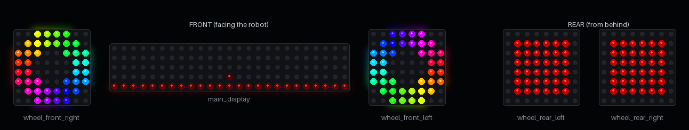
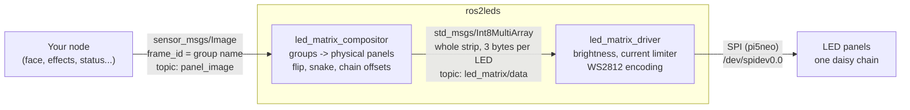
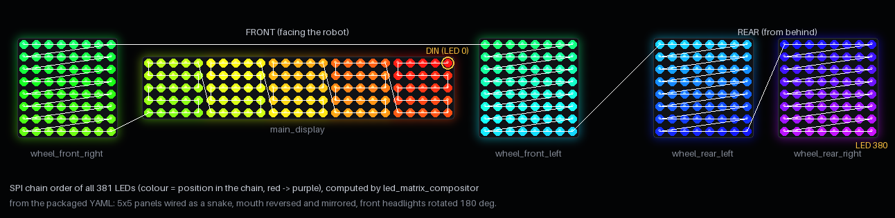
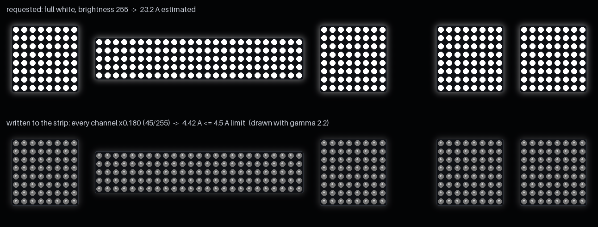
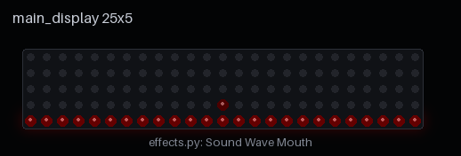
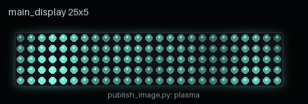
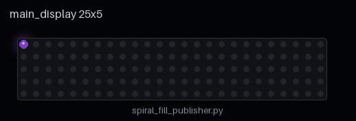
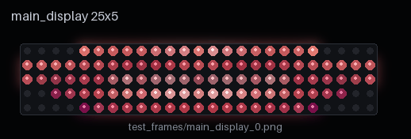
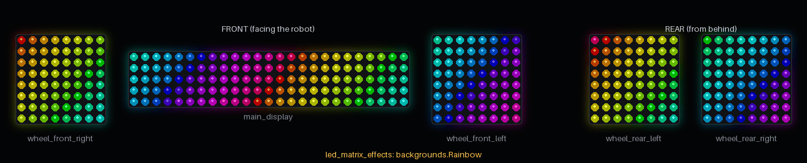
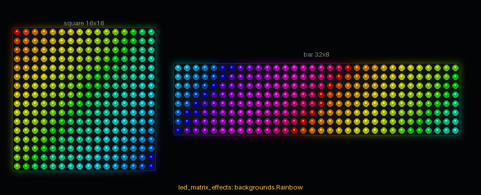

# ros2leds

[](https://github.com/krikz/ros2leds/actions/workflows/ci.yml)
[](LICENSE)


**Drive a chain of WS2812B (NeoPixel) LED panels from ROS 2 on a Raspberry Pi 5 — and address
them as named, rectangular displays instead of one long strip.**



<sub>Rendered from the code in this repo by
[`docs/tools/render_preview.py`](docs/tools/render_preview.py): the mouth runs the five modes of
[`effects.py`](effects.py), the headlights a rainbow ring, the rear panels a blinking tail light.</sub>

You wire all panels into one SPI chain. You describe the panels and how they form logical
displays in one YAML file. Then any node publishes an ordinary `sensor_msgs/Image` with the
display name in `header.frame_id` — and the pixels end up on the right LEDs, whatever the
wiring order, snake pattern or mounting orientation.

## Features

- **Logical groups.** Combine several physical panels into one display (five 5x5 panels become
  one 25x5 mouth) or address a single panel by name (`wheel_front_left`).
- **Any wiring.** Per-panel serpentine ("snake") wiring, per-group mirroring (`flip_x`,
  `flip_y`), panels in any chain order, grids of panels (`arrangement: [cols, rows]`).
- **Plain ROS 2 images.** Input is `sensor_msgs/Image` (`rgb8`), so anything that can publish an
  image — Python, C++, `ros2 topic pub`, `cv_bridge` — can draw on the panels.
- **One SPI write per frame.** The compositor merges updates of all groups and sends the whole
  strip at most `max_publish_hz` times per second (default 60), only when something changed.
- **Current limiter.** The driver estimates the strip current per frame and dims the whole frame
  uniformly if it would exceed the power budget (default 4.5 A) — colours stay the same.
- **Global brightness** in the driver (default 25/255, about 10 %).
- **Safe shutdown.** The driver blanks the strip on exit and retries if the SPI write fails, so
  the LEDs do not stay lit.
- **Runs without hardware.** Without `pi5neo` the driver starts in simulation mode; the logic is
  covered by tests that need neither ROS nor a Raspberry Pi.

## How it works



| Package | Node | Subscribes | Publishes |
|---|---|---|---|
| `led_matrix_compositor` | `led_matrix_compositor` | `panel_image` (`sensor_msgs/Image`, `rgb8`) | `led_matrix/data` (`std_msgs/Int8MultiArray`) |
| `led_matrix_driver` | `led_matrix_driver` | `led_matrix/data` (`std_msgs/Int8MultiArray`) | — (writes to SPI) |
| `led_matrix_effects` | — (a Python library) | — | — |

`led_matrix_effects` draws the pictures your node publishes: backgrounds, pulses, signals and lamp themes
over all panels at once ([below](#effects-library-led_matrix_effects)).

`led_matrix/data` carries the whole strip in chain order, `R, G, B` per LED, each byte stored as
`channel - 128` (historical wire format). Applications normally never touch this topic.

### Example: the rover this was built for

381 LEDs in one chain: five 5x5 panels form the 25x5 mouth `main_display`, four 8x8 panels are
two headlights and two tail lights. The picture below is computed by the real compositor from
the packaged [`led_matrix_compositor.yaml`](led_matrix_compositor/config/led_matrix_compositor.yaml):
each LED is coloured by its position in the SPI chain and the white line follows the data from
LED 0 to LED 380.



The 5x5 panels are wired as snakes; the whole front is mounted rotated by 180°, so the mouth
panels are listed in reverse with `flip_x: true` and the right headlight is flipped in both
axes. Applications do not care — they draw an upright 25x5 image.
(Panel spacing in the picture is illustrative.)

## Quick start

Requirements: ROS 2 Humble (other ROS 2 distributions should work but are not tested in CI),
Python 3, PyYAML; on the Raspberry Pi 5 also SPI enabled and
[`pi5neo`](https://pypi.org/project/Pi5Neo/).

```bash
mkdir -p ~/ros2_ws/src && cd ~/ros2_ws/src
git clone https://github.com/krikz/ros2leds.git
cd ~/ros2_ws
pip3 install pi5neo --break-system-packages     # on the Raspberry Pi only
colcon build --packages-select led_matrix_driver led_matrix_compositor
source install/setup.bash
```

Start the driver and the compositor with the packaged configs:

```bash
# Terminal 1: driver (simulation mode if pi5neo is not installed)
ros2 launch led_matrix_driver led_matrix_driver_launch.py

# Terminal 2: compositor
ros2 run led_matrix_compositor led_matrix_compositor --ros-args \
  -p config_file:=$(ros2 pkg prefix led_matrix_compositor)/share/led_matrix_compositor/config/led_matrix_compositor.yaml
```

> **Note.** `led_matrix_compositor_launch.py` starts both nodes but looks for its configs in
> `/config/led_matrix/` and `/ws/install/...` (the Docker layout of the rover). Outside that
> layout use the two commands above.
>
> When starting the driver with `ros2 run` add `-r __node:=led_matrix_driver`, otherwise the
> parameters in `led_matrix_driver.yaml` are not applied (the node's default name is
> `led_matrix_simple`).

### Draw something

A red bar on the left headlight, from the command line:

```bash
python3 -c "print('[' + ','.join(['255,0,0']*16 + ['0,0,0']*48) + ']')" > /tmp/px.txt
ros2 topic pub --once /panel_image sensor_msgs/msg/Image \
  "{header: {frame_id: wheel_front_left}, height: 8, width: 8, encoding: rgb8, step: 24,
    data: $(cat /tmp/px.txt)}"
```

From Python — a moving rainbow on the 25x5 mouth:

```python
import colorsys

import numpy as np
import rclpy
from rclpy.node import Node
from sensor_msgs.msg import Image


class Rainbow(Node):
    def __init__(self):
        super().__init__('rainbow')
        self.pub = self.create_publisher(Image, 'panel_image', 10)
        self.t = 0.0
        self.create_timer(1 / 30, self.tick)

    def tick(self):
        w, h = 25, 5
        img = np.zeros((h, w, 3), np.uint8)
        for x in range(w):
            r, g, b = colorsys.hsv_to_rgb((x / w + self.t) % 1.0, 1.0, 1.0)
            img[:, x] = (int(r * 255), int(g * 255), int(b * 255))
        msg = Image()
        msg.header.frame_id = 'main_display'   # the logical group
        msg.width, msg.height = w, h
        msg.encoding, msg.step = 'rgb8', w * 3
        msg.data = img.tobytes()
        self.pub.publish(msg)
        self.t += 0.01


rclpy.init()
rclpy.spin(Rainbow())
```

The image size must match the group size exactly (`main_display` is 25x5); otherwise the frame
is dropped with a warning.

## Configuration

### Panels and groups (`led_matrix_compositor.yaml`)

```yaml
led_matrix_compositor:
  ros__parameters:
    # Physical panels in chain order, starting at the panel wired to the Pi.
    physical_panels:
      - {width: 5, height: 5, snake_connection: true}   # 0
      - {width: 5, height: 5, snake_connection: true}   # 1
      - {width: 8, height: 8}                           # 2

    # Logical groups: what applications draw on.
    logical_groups:
      - name: mouth
        physical_indices: [0, 1]   # row-major within the arrangement
        arrangement: [2, 1]        # [columns, rows] of panels -> a 10x5 display
      - name: headlight
        physical_indices: [2]
        arrangement: [1, 1]
        flip_x: true               # panel mounted mirrored

    input_topic: panel_image
    output_topic: led_matrix/data
    max_publish_hz: 60.0           # 0 = publish the strip on every incoming image
```

| Key | Where | Meaning |
|---|---|---|
| `width`, `height` | panel | LEDs per row / per column |
| `snake_connection` | panel | serpentine wiring: every other row runs backwards |
| `snake_start_row`, `snake_invert` | panel | which rows are reversed (default: odd rows) |
| `physical_indices` | group | panels of the group, row by row |
| `arrangement` | group | `[columns, rows]` of panels in the group |
| `flip_x`, `flip_y` | group | mirror each panel of the group horizontally / vertically |
| `snake_arrangement` | group | odd rows of *panels* run right-to-left |

The full rover config is [`led_matrix_compositor/config/led_matrix_compositor.yaml`](led_matrix_compositor/config/led_matrix_compositor.yaml).

### Driver (`led_matrix_driver.yaml`)

| Parameter | Default in YAML | Meaning |
|---|---|---|
| `num_leds` | `381` | LEDs in the chain (must match the compositor's panels) |
| `spi_device` | `/dev/spidev0.0` | SPI device |
| `spi_speed_khz` | `1000` | SPI clock |
| `brightness` | `25` | global brightness 0..255, applied as `v * brightness // 255` |
| `max_current_ma` | `4500.0` | current budget for the strip; `<= 0` disables the limiter |
| `ma_per_channel` | `20.0` | current of one colour channel at full PWM (WS2812B datasheet) |
| `idle_ma_per_led` | `1.0` | quiescent current per LED |
| `min_frame_interval_s` | `0.0003` | minimum gap between writes (WS2812 latch) |
| `queue_depth` | `1` | subscription depth: only the latest strip matters |

## Current limiter

WS2812B LEDs draw up to ~60 mA each at full white. 381 of them would need about 23 A — far more
than a typical 5 V supply. After applying `brightness`, the driver estimates the frame current
(`idle + sum(channels) / 255 * ma_per_channel`) and, if it exceeds `max_current_ma`, scales
**every channel by the same factor**, so the picture keeps its colours and just gets dimmer.
At most one warning per minute is logged with the number of limited frames.



<sub>Full white at brightness 255: 23.2 A estimated, scaled by 0.18 to 4.42 A. Numbers come from
the driver's `frame_math` module.</sub>

## Example publishers

The scripts in the repository root are small standalone ROS 2 nodes that publish to
`main_display` (25x5). They are examples, not part of the packages.

| | |
|---|---|
|  | [`effects.py`](effects.py) — five audio-reactive "mouth" modes driven by the level of the system audio output (needs `sounddevice` and PulseAudio). Above with a synthetic level. |
|  | [`publish_image.py`](publish_image.py) — a plasma effect. |
|  | [`spiral_fill_publisher.py`](spiral_fill_publisher.py) — fills the display in a spiral, then restarts in a new colour. |
|  | [`directory_image_publisher.py`](directory_image_publisher.py) — plays PNG/JPG files named `<group>_<n>.png` from a folder, e.g. [`test_frames/`](test_frames) (needs OpenCV). |

## Effects library: `led_matrix_effects`



<sub>Every frame above is computed by the package on the packaged compositor config
(`docs/tools/render_preview.py`) and quantised as the driver shows it at brightness 25.</sub>

A pure-Python package (numpy only, no ROS import) of effects for the panels of this repo. It knows
the panels from the same `led_matrix_compositor.yaml` the compositor reads, puts them on one
**canvas**, and draws effects that run across all of them, a wave that goes from one headlight
through the mouth to the other. Your node only turns a frame into images (see
[Draw something](#draw-something)).

```python
from led_matrix_effects import Canvas, Layout, Rainbow, Slash, Strip

# Panels and sizes from the compositor config; optional: your names for the groups and where
# each panel sits on the canvas (default: side by side, one LED apart).
layout = Layout.from_compositor('led_matrix_compositor.yaml')
canvas = Canvas(layout)
strip = Strip(layout.n_leds, brightness=25)       # the driver's brightness and current model

rainbow, slash = Rainbow(canvas), Slash(canvas)
t = 1.0                                           # seconds
frame = slash(0.1, rainbow(t))                    # a background, then a pulse over it
for panel, levels in frame.panels().items():
    group = layout.group_of[panel]                 # -> header.frame_id of the Image
    data = strip.to_wire(levels).tobytes()         # rgb8 bytes, (width, height) = layout.size[panel]
print(strip.frame_ma(frame), 'mA')                # current of the frame by the driver's model
```

| Module | What it has |
|---|---|
| `layout` | `Layout` (panels, sizes, compositor groups, canvas places; `Layout.from_compositor`), `Frame` (one picture: an `(h, w, 3)` array per panel) |
| `canvas` | `Canvas`: every LED with its canvas `(x, y)` as flat numpy rows; `flat` / `split` between a frame and the rows |
| `backgrounds` | `Rainbow`, `Fire`, `MatrixRain(seed=...)`, and `under(canvas, picture, background)`: the background through the picture, dimmed around it |
| `pulses` | one-shot `Slash`, `Glitch(seed=...)`, `Boot(order=...)`, `PowerDown(centre=...)`, each with its `duration` |
| `signals` | `beacon`, `flasher` (round lamp on any panel), `police_pattern`, `roadworks_pattern`, `doom_fire` + `fire_color`, `ECG`, `CROSS`, `CHEVRON` |
| `lamps` | `THEMES` for a pair of lamps: tail light, hazard, party, holiday sprites; music `speaker_rings`, `eq_bars`, `disco` |
| `geometry` | panel size and colour scale of `signals` / `lamps`: `lamp_grid(size)`, `fit(sprite, size)`, `scaled(picture, levels)` |
| `power` | `Strip`: levels to wire bytes, `frame_ma` / `wire_ma`; `Strip.from_driver('led_matrix_driver.yaml')` |
| `preview` | `render(canvas, frame)` to a `PIL.Image`, `save_gif` (needs Pillow) |

**Levels, not bytes.** Effects draw in *levels* `0..brightness` (`Strip.max_level`). At the
driver's brightness 25 only 26 shades per channel reach the LEDs (`v * 25 // 255`); a level
`L` goes out as `ceil(L / 25 * 255)` and comes back from the driver exactly as `L`, so every
shade an effect picks is visible. Colours of the pictures are written for 25 levels; pass
`levels=strip.max_level` to signals, lamps and pulses on a strip with another brightness.
Backgrounds take a `level` (default 6 of 25) to stay below what is drawn over them and to keep
the strip current low; scale it the same way.

**Deterministic.** Everything is a function of `t` and fixed seeds (`MatrixRain(seed=...)`,
`Glitch(seed=...)`, the lamp themes): the same `t` gives the same frame. The tests pin the
wire bytes (`tests/test_effects.py`, `tests/test_effects_sizes.py`); raw floats may differ in
the last bit between platforms (`np.sin`), the rounding to levels hides that.

### Your own matrices



<sub>One 16x16 matrix and one 32x8 bar in one chain,
[`docs/examples/own_matrices.yaml`](docs/examples/own_matrices.yaml), rendered by
`docs/tools/render_preview.py`.</sub>

Nothing in the package assumes the rover. Describe your panels to the compositor:

```yaml
led_matrix_compositor:
  ros__parameters:
    physical_panels:
      - {width: 16, height: 16, snake_connection: true}   # 0: square matrix
      - {width: 32, height: 8, snake_connection: true}    # 1: long bar
    logical_groups:
      - {name: square, physical_indices: [0], arrangement: [1, 1]}
      - {name: bar, physical_indices: [1], arrangement: [1, 1]}
```

and draw on them with the same config:

```python
from led_matrix_effects import Canvas, Layout, Rainbow, Strip, lamps, signals

layout = Layout.from_compositor('own_matrices.yaml', at={'square': (0, 0), 'bar': (18, 4)})
canvas = Canvas(layout)
strip = Strip(layout.n_leds, brightness=64)        # your driver's brightness
lv = strip.max_level                               # 64 levels instead of 25

frame = Rainbow(canvas, level=6 * lv / 25)(t)      # a background across both panels
frame.square = lamps.THEMES['new_year'](t, size=layout.size['square'], levels=lv)[0]
frame.bar = signals.beacon(t, signals.BLUE, size=layout.size['bar'], levels=lv)
```

- **Canvas effects** (`backgrounds`, `pulses`) work on any layout: they only use the panel sizes
  and canvas places.
- **Procedural pictures** (`beacon`, `flasher`, tail light, turn signal, rings, equaliser, disco)
  take `size=(width, height)` and are computed on that grid. The lens fills a square panel and
  becomes an ellipse on a long one (`geometry.lamp_grid`).
- **Sprites** (holiday themes) are 8x8 pictures. On a bigger panel they are enlarged by the
  largest integer factor that fits, nearest neighbour, and centred (`geometry.fit`). On a panel
  smaller than 8x8, for example 5x5, they raise `SpriteTooSmall` instead of a mangled picture.
- **Defaults** (`size=(8, 8)`, `levels=25`) give exactly the pictures the rover shows; the tests
  pin them.

Build it next to the nodes: `colcon build --packages-select led_matrix_effects` (depends on
`python3-numpy`; `python3-yaml` to read the YAML files, Pillow only for `preview`).

## Hardware

```
Raspberry Pi 5            LED chain
GPIO 10 (SPI0 MOSI)  ->   DIN of the first panel
GND                  ->   GND (common with the LED power supply)
                          5 V from a separate supply sized for the current budget
```

The driver uses SPI to generate the WS2812 bit stream (8 SPI bits per data bit, GRB order) via
`pi5neo`.

## Development

```bash
pip install pytest pyyaml numpy pillow
python -m pytest tests -v          # driver + compositor logic (ROS and pi5neo stubbed), effects
```

CI ([`.github/workflows/ci.yml`](.github/workflows/ci.yml)) runs these tests on Python 3.10 and
3.12 and, in a `ros:humble-ros-base` container, builds the three packages with colcon, loads
the installed `led_matrix_effects` with the packaged config, starts the nodes and checks that
an image sent to `main_display` comes out as a full 381-LED strip.

The pictures in this README are generated, not drawn:

```bash
pip install numpy pillow pyyaml
python docs/tools/render_preview.py   # rewrites docs/images/
```

## FAQ

**My image is ignored.** Check the compositor log: the group name in `header.frame_id` must
exist, the encoding must be `rgb8`, and `width`/`height` must equal the group size. Each problem
is reported with a warning.

**The picture is mirrored or the rows are shuffled.** Set `snake_connection` for serpentine
panels, then fix the orientation with `flip_x` / `flip_y` on the group. A test frame with an
asymmetric letter (e.g. "F") makes this quick.

**Several nodes draw on different groups — do they fight?** No. The compositor keeps one buffer
for the whole strip; each image only replaces the LEDs of its group.

**Do I need a Raspberry Pi to try it?** No. Without `pi5neo` the driver runs in simulation mode,
and the tests run on any machine.

**Why `Int8MultiArray` between compositor and driver?** Historical wire format; the bytes are
`channel - 128`. It is an internal topic — publish images to the compositor instead.

## License

[MIT](LICENSE) © krikz
